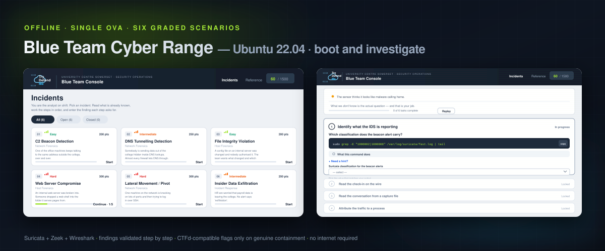
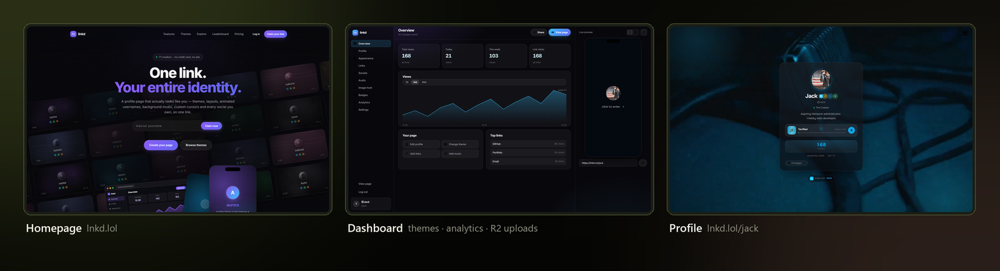
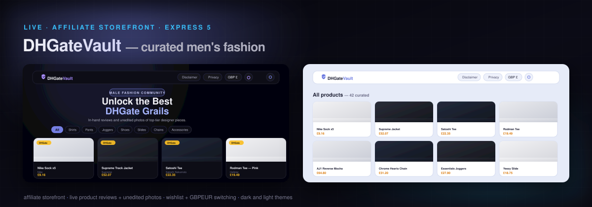
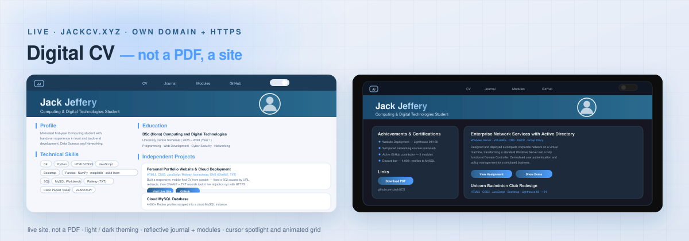
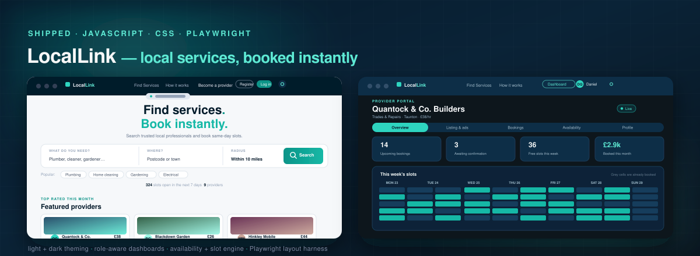

I build systems end to end from the database schema, to the API, the frontend, and the deploy.
Recent work spans a **local-services booking platform**, **lnkd.lol** in production,
Discord automation, and a self-contained defensive-security cyber range. 
All images are not necessarily representative of the current nature of the project as they have been converted to SVG's with AI

---

## 🛠 Tech I work with

**Languages**

**Frameworks & libraries**

**Infrastructure & security**

---

## 🏆 Featured project

### Blue Team Target VM Cyber Range
> 🔒 Private repository happy to walk through it on request

<b>Incidents board</b> — six graded scenarios, progress tracked · <b>Blue Team Console</b> — staged investigation with validated findings

A pre-built, portable **Ubuntu 22.04 LTS defensive-analysis desktop** shipped as a
single OVA. Designed to be handed to a student on a USB stick.
Boot it log-in and Investigate

It bundles Suricata, Zeek, Wireshark, tcpdump and other tools alongside a custom interactive incident
console and a CTFd scoreboard, then runs **six self-starting graded scenarios**
that plant realistic but entirely benign attacks:

| # | Scenario | Category | Points |
|---|----------|----------|--------|
| 1 | C2 Beacon Detection | Network Forensics | 200 |
| 2 | DNS Tunnelling Detection | Network Forensics | 200 |
| 3 | File Integrity Violation | Host Forensics | 250 |
| 4 | Web Server Compromise | Host Forensics | 300 |
| 5 | Lateral Movement / Pivot | Network Forensics | 300 |
| 6 | Insider Data Exfiltration | Incident Response | 400 |

Each scenario releases a **CTFd-compatible flag only when the objective is
 met** the typical flow is "identify *and* contain", not just spot it.

**Engineered for real deployment:** a shared shell library drives flag state across
all scenarios, a Python API exposes progress, a React/TypeScript HUD serves the
story and reference material, and CTFd is seeded and bootstrapped automatically.
Full instructor guide, investigation handbook, glossary and troubleshooting docs ship
with it.

`Python` · `TypeScript` · `React` · `Bash` · `Vagrant` · `Proxmox` · `Suricata` · `Zeek` · `CTFd`

---

## 📌 Other projects

### linkd live at [lnkd.lol](https://lnkd.lol)
> 🔒 Private repository — running in production currently in development

<b>Homepage</b> · <b>Creator dashboard</b> — 16 themes, analytics, direct-to-R2 uploads · <b>A live profile</b>

A self-hosted link-in-bio profile builder: 16 themes, 4 layouts, 12 custom cursors,
11 animated username effects, 7 canvas particle effects, background audio with an
upload library, a media host and real analytics every profile has its own URL.

Express 5 with PostgreSQL on **Supabase**, JWT + bcrypt auth, and direct-to-**Cloudflare R2**
uploads via presigned URLs — the 25 MB file never touches the server, and storage stays
cheap and durable when the app's own filesystem is ephemeral. A Playwright suite covers
the build end to end, including a real-browser upload test against R2.

[**lnkd.lol →**](https://lnkd.lol)

`JavaScript` · `Express` · `PostgreSQL` · `Supabase` · `Cloudflare R2` · `JWT` · `Playwright`

### dhgVAULT — live at [dhgatevault.com](https://dhgatevault.com)
> 🔒 Private repository — running in production

<b>Curated storefront</b> — category filters, live prices, wishlist · <b>Dark + light themes</b> — glass surfaces, per-product reviews

An affiliate storefront for curated men's fashion: in-hand reviews and unedited photos
of designer pieces, with category filtering, a wishlist, currency switching and
per-product photo galleries. Every listing carries a live price and a link out.

Express 5 backend with an authenticated admin panel, wishlist system, sharp-based
image pipeline, and an esbuild build step minifying every asset. Includes security
headers, request-IP tracking, and SEO files.

`JavaScript` · `Express` · `Node` · `sharp` · `esbuild`

### Digital-CV — live at [jackcv.xyz](https://jackcv.xyz)
> 🔒 Source private — the site itself is public

<b>CV</b> — profile, skills, education, projects · <b>Journal + Modules</b> — reflective coursework log · <b>Dark theme</b>

A live CV with light/dark theming, a cursor spotlight, animated grid
background, and dedicated modules and reflective-journal sections. Deployed on Railway
on its own domain, so the DNS work (CNAME, TXT verification, fixing a 502 from URL
redirects) was part of the build, not an afterthought.

[**jackcv.xyz →**](https://jackcv.xyz) · [View the PDF →](https://github.com/JackUCS/Digital-CV/blob/main/JackJefferyCV.pdf)

`HTML` · `CSS` · `JavaScript`

### LocalLink local services, booked instantly
> 🔒 Private repository — design workup is [public here](https://github.com/JackUCS/LocalLink)

<b>Homepage</b> — search by what · where · radius, live slot counts · <b>Provider portal</b> — bookings, availability grid, listing management

A local-services marketplace where a customer searches by **what · where · radius**,
sees a provider's *real* availability and books a slot — and where a provider gets a
portal that runs their diary. Not a mockup: 11 pages, three roles, 15 JS modules, zero dependencies.

[**Open the design workup →**](https://github.com/JackUCS/LocalLink)

`JavaScript` · `CSS` · `Playwright` · `Design tokens` · `UX` · `a11y`

### [Roblox-Monitoring-Final](https://github.com/JackUCS/Roblox-Monitoring-Final) — automated monitor & alerter
Python service polling game servers via `aiohttp`, persisting state to MySQL, and
pushing webhook alerts. Deployed on Railway with environment-based config.

`Python` · `aiohttp` · `MySQL` · `Railway`

### [PublicInterface](https://github.com/JackUCS/PublicInterface) — Discord slash-command bot
Command interface over a MySQL backend — users register webhook endpoints and the bot
routes alerts to them, with slash-command sync on startup.

`Python` · `discord.py` · `MySQL` · `Railway`

---

## 📊 Stats

---

## 🧭 About me

- 🎓 Studying at **UCS**  Programming, networking, cyber security, data science and web
- 🛡️ Most proud of building the **Blue Team cyber range** end to end
- 🔭 Currently implementing **LocalLink's** back-end 
- 🌱 Learning **backend architecture and secure deployment considerations**
- 💬 Ask me about **Python bots, Express APIs, or MySQL schemas**

## 🎯 Outside of code

- 🎮 **Gaming** ARPGs and looter shooters (*Path of Exile 2*, *Destiny 2*),
  hero shooters and battle royales (*Fortnite*, *Apex Legends*), plus *Rocket League*,
  *Call of Duty* and *Geometry Dash*
- 🎧 **Music** EDM and hyperpop
- 🎨 **Design** UI mockups, wireframes, and interface work

---

### 📫 Get in touch

